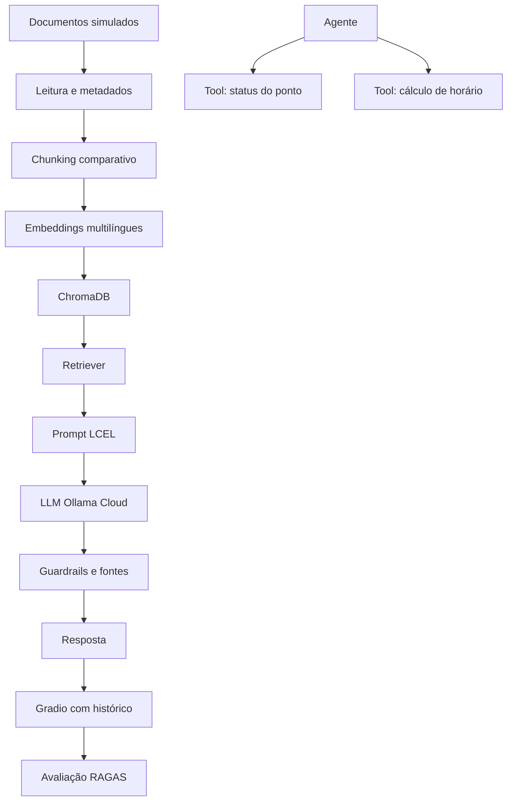

# CitizenTech — Assistente de Mobilidade Urbana

## 1. Visão geral
Protótipo acadêmico de assistente municipal para consultas sobre a linha fictícia 714: itinerário, horários, acessibilidade e interdições. Frente escolhida: **A — Mobilidade urbana**. Cenário: município fictício de Vila das Acácias.

## 2. Estrutura
```text
GS2026_2_CitizenTech_Mobilidade/
├── 1_Notebook_GS2026_2.ipynb
├── 2_base_documental/
│   ├── doc_01_itinerario.txt
│   ├── doc_02_horarios.txt
│   └── doc_03_comunicado_interdicao.txt
├── 3_avaliacao_ragas.json
├── 4_README.md
├── 5_certificacao.txt
└── 6_Chat_Log.txt
```

## 3. Pipeline


## 4. Base documental e armadilha
A base contém três documentos simulados, cada um com mais de 100 palavras. O documento de 10/08/2026 descreve o ponto 714-08 com embarque em nível e piso tátil. O comunicado de 15/10/2026 informa que o ponto está interditado desde essa data até liberação formal. O comunicado posterior prevalece. O ponto alternativo 714-09 não tem acessibilidade certificada na documentação.

Detalhe de apoio: em domingos com feira livre autorizada na Praça das Palmeiras, entre 06h e 12h, o ponto final pode ser deslocado para a Rua Ipê Amarelo, aproximadamente 180 metros da praça.

## 5. Decisões técnicas
- Chunking: comparação de 500 caracteres/overlap 80 e 900/overlap 120. O notebook inicia com 900/120 para preservar contexto; validar com busca e justificar com resultados.
- Embeddings: `paraphrase-multilingual-MiniLM-L12-v2`.
- Banco vetorial: ChromaDB com `doc_id`, `data_publicacao`, tema e posição do trecho.
- RAG: LCEL, citação de fontes e resposta de insuficiência.
- Agente: consulta de status e cálculo da próxima partida.
- Interface: Gradio ChatInterface com histórico.
- Segurança: filtro de escopo, neutralização de instrução maliciosa, proteção de dados pessoais e limite de confiança.
- LLM: Ollama Cloud por endpoint compatível com OpenAI; modelo configurável em `OLLAMA_MODEL`.

## 6. Execução
1. Abra o notebook no Google Colab.
2. Faça upload da pasta `2_base_documental` para `/content/2_base_documental`.
3. Em Colab → Secrets, crie `OLLAMA_API_KEY` e habilite acesso.
4. Execute Runtime → Run all.
5. Preencha manualmente os ground truths na Seção 7 e execute a avaliação.
6. Baixe o JSON medido e substitua o arquivo inicial do pacote.
7. Registre prints da busca, tools, interface, guardrails e métricas.
8. Complete turma, nomes/RMs, links e vídeo.

Nunca inclua a chave Ollama no notebook, ZIP, repositório ou prints.

## 7. Avaliação RAGAS
O conjunto padrão contém oito perguntas (quatro simples e quatro armadilha). O ground truth deve ser escrito e validado pelo grupo, conforme briefing. Se os campos estiverem vazios, o notebook salva status pendente, sem fabricar métricas. Após preenchimento, executa RAGAS e exporta resultados por pergunta e médias: faithfulness, answer relevancy, context precision e context recall. Para entrega individual, reduzir para seis perguntas (três simples + três armadilha).

## 8. Limitações e produção
Os dados são fictícios e não devem orientar deslocamentos reais. Em produção seriam necessários dados oficiais, integração com sistemas operacionais, monitoramento, validação humana, testes de acessibilidade, controle de acesso, retenção adequada e conformidade com a LGPD.

## 9. Evidências
Inserir prints reais de: comparação de chunking e busca semântica; respostas RAG com fontes; trace do agente e erro controlado; interface; guardrails; tabela e médias RAGAS.

## 10. Referências técnicas
- Ollama API: https://docs.ollama.com/api
- LangChain: https://python.langchain.com/docs/
- ChromaDB: https://docs.trychroma.com/
- Ragas: https://docs.ragas.io/
- Gradio: https://www.gradio.app/docs/
